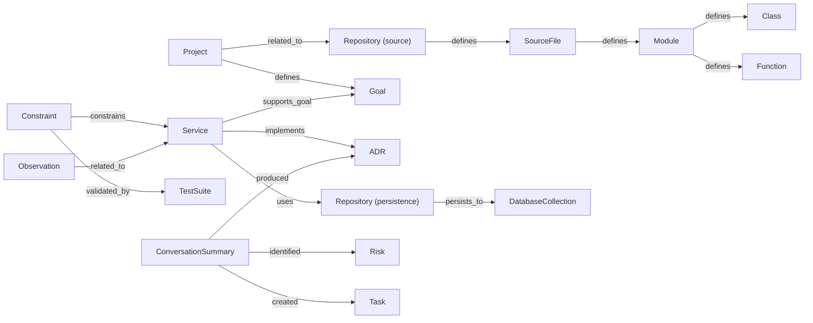

# MemoryGraphMCP architecture metamodel

The architecture graph stores typed vertices in `architecture_entities` and relationships in `architecture_edges`. Each vertex has a stable key, a type, a name, an optional description and source path, and metadata. Indexed vertices also track the repository and whether the node is current or stale.

## Node types

| Type | Represents | Type-specific data |
|---|---|---|
| `Project` | A body of work | Goals, tasks, and repositories can be linked |
| `Goal` | A project objective | Project, status, success criteria, and supporting ADRs, services, and tasks |
| `Task` | A unit of work | Status |
| `ADR` | An architectural decision | Optional key for the full ADR with status, rationale, validity, and validation history |
| `DomainConcept` | A term or concept in the domain | Optional key for the full memory record |
| `Service` | An application or system service | Common node fields |
| `Repository` | A code repository or a persistence component | `source` or `persistence` role |
| `Module` | A source module | Qualified name and imports |
| `Class` | A class declaration | Qualified name |
| `Function` | A function or method declaration | Qualified name and async flag |
| `SourceFile` | A file in a source repository | Required source path |
| `ApiEndpoint` | An HTTP endpoint | Method and path |
| `DatabaseCollection` | A persisted collection | Common node fields |
| `TestSuite` | Tests for behavior or constraints | Common node fields |
| `Constraint` | An architectural rule | Rule, scope, authority, enforcement status, constrained entities, and validating tests |
| `Risk` | An identified architectural or project risk | Common node fields |
| `Observation` | A recorded agent finding | Source, summary, confidence, timestamp, related entities, and optional recorder |
| `ConversationSummary` | A concise account of an interaction | Summary, timestamp, optional source and recorder, and linked ADRs, risks, and tasks |

## Relationships

These are example connections. Workflows such as project goal creation and constraint recording check target node types. The generic link tool accepts any two distinct existing nodes and a supported relationship.

| Stored direction | Inverse when traversed backward |
|---|---|
| `implements` | `implemented_by` |
| `defines` | `defined_in` |
| `uses` | `used_by` |
| `persists_to` | `persisted_by` |
| `constrained_by` | `constrains` |
| `validated_by` | `validates` |
| `references` | `referenced_by` |
| `supersedes` | `superseded_by` |
| `supports_goal` | `supported_by` |
| `related_to` | `related_to` |
| `produced` | `produced_by` |
| `identified` | `identified_by` |
| `created` | `created_by` |

An edge stores its endpoints, relationship type, source, confidence from zero to one, creation time, and update time. Inverse relationships are resolved during traversal. A source repository and project retain separate identities. A project can link to several source repositories and a repository can link to several projects.

Find a Project with `search_architecture_entities` and call
`get_project_guidance(project_key)` to read its current accepted structured ADRs,
active constraints, and validating test keys. Guidance excludes expired or
future decisions, proposals, and retired constraints. Use the ADR record key,
source fields, and validation evidence when citing decisions. The tool offers
context for Codex, Claude, and other MCP clients. Follow repository development
rules from `AGENTS.md`.

The server provisions `architecture_entities` and `architecture_edges` alongside
the existing memory collections. For pre-provisioning or custom names, set
`MGMCP_ARANGO_ARCHITECTURE_ENTITIES_COLLECTION` and
`MGMCP_ARANGO_ARCHITECTURE_EDGES_COLLECTION`. Existing memory documents are
preserved. Use `import_architecture_memory` to link existing ADRs and domain
concepts, or `python -m scripts.index_architecture --help` for code indexing.
