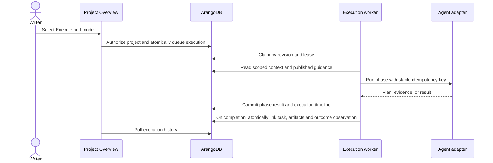

# Recoverable capture and task execution

Project Overview opens on Tasks with Open and In progress selected. Writers can create tasks, goals, risks, and constraints. Select **Help me draft** to generate editable text with the configured local model. The model call does not save a record. Writers can mark a task complete with an outcome and evidence, which creates a linked Observation in the same graph transaction.

## Capture operations

Open **Knowledge capture** on Project Overview. The panel shows last successful poll, poll age, pending count and oldest pending event for the journal and spool, the latest observed versus stored GitHub cursor, last failure, and scheduled retry. Backoff is exponential and capped at one hour. A database outage prevents the worker from recording status during the outage. The previous successful poll age and persisted checkpoint become visible once storage returns.

| Source | Durable progress |
| --- | --- |
| Commits | Last fully processed branch SHA. GitHub compares the saved SHA to the current head and paginates the comparison. The worker saves the new SHA after all observations succeed. |
| Pull requests | Last processed update timestamp. The worker paginates updates with a five-minute overlap and checks that the top update stayed stable during a scan. |
| Index | Last successfully handled GitHub branch head. It can be retried independently of commit or PR capture. |
| Spool | The producer writes complete files to a mounted spool. Files are acknowledged by deletion only after capture. Invalid envelopes are renamed to `.invalid` and surfaced as failures. |
| Graph | CI and tracker events are selected from the durable event journal until a corresponding stable observation exists. ADRs, constraints, tasks, conversations, and index revisions are also reconciled from current graph state. |

On first startup, GitHub streams capture the newest 25 items. Use **Replay** to re-scan GitHub from a UTC date while preserving the live cursor. Use **Backfill** to import older history and establish a baseline if one is absent. For commits, after a force-push the worker stops and displays that the old head is unreachable. A writer can then backfill the new branch from a chosen date to establish its new cursor. Scans are bounded to 10,000 upstream items. Choose a narrower start date if the bound is reached. GitHub exposes current PR state and reachable commit history. Intermediate PR states and revisions overwritten before a poll may not be recoverable from the upstream API.

Observations use stable identities. If the process stops after writing an observation and before saving its cursor, the restarted worker re-reads the range and skips stored observations. This is at-least-once source processing with idempotent graph writes.

## Agent execution

| Agent | Setup |
| --- | --- |
| Local model | Use the existing `MGMCP_TEST_FIX_OLLAMA_URL` and `MGMCP_TEST_FIX_OLLAMA_MODEL`. The built-in local adapter supports Plan and Review, plus record drafting. |
| Codex, Claude Code, OpenHands, local coding agent | Set `MGMCP_WORKSPACE_AGENT_URLS` to a JSON map of operator-managed adapter addresses, for example `{"codex":"http://agent-bridge:8080"}`. Supported keys are `codex`, `claude-code`, `openhands`, and `local`. Set `MGMCP_WORKSPACE_AGENT_TOKEN` when adapters require bearer authentication. |

An adapter accepts `POST /plan`, `/execute`, `/review` and `/cancel`. A phase request carries an `execution_id`, a structured prompt, and an `Idempotency-Key` of `<execution_id>:<phase>`. Cancel receives the same execution ID and its own stable idempotency key. The bridge must durably deduplicate phase requests before side effects, enforce its project and repository allowlist, isolate writable workspaces, and retain the terminal result across retries. It must keep repository publishing subject to separate approval. Cancellation should prevent future work for that execution ID and stop any current operation where possible. Provider URLs come from server configuration. Use HTTPS for adapters outside a trusted local network.

An adapter returns structured JSON with required `summary` and optional `plan`, `files_modified`, `tests`, `pull_request`, `review_comments`, `logs`, `artifacts` (name and reference), `lesson`, and `completed`. Set `completed` only when the implementation or final review is verified. A human can also complete a task with a recorded outcome. Production adapters are deployed separately from MemoryGraphMCP.

Execution records store actor, timestamps, phase, results, context links, and outcome counts and duration. An expired lease can be reclaimed after restart. Repeated provider requests require the adapter's idempotency contract. Graph links to ADRs, goals, constraints, and components identify supplied context. A link by itself makes no assertion that an ADR was implemented. Task state keeps the existing tracker-compatible values.

## Storage and rollout

The graph adds `Execution`, `Agent`, and `Artifact` discriminators in `architecture_entities`. Relationships use the existing `architecture_edges` collection and inverse relationship definitions. Checkpoints use `capture.checkpoint` rows in `architecture_events`. The migration is additive and on demand. Existing nodes and edges require no data rewrite or expanded runtime permissions. Deploy the API and Review UI together, then open Project Overview. Configure GitHub capture using `docker-compose.capture.yml` as before. Existing installs start with the newest-25 rule and can use Backfill to establish historical coverage.

The isolated ArangoDB test can be enabled with `MGMCP_RECOVERY_TEST_HOST` and `MGMCP_RECOVERY_TEST_PASSWORD` against a disposable database server.

### Agent Settings

Administrators can open **Agent Settings** in the sidebar. Choose Codex, Claude Code, OpenHands, or Ollama, enter an approved endpoint, and save. The worker picks up saved changes without a restart. Active executions must finish or be cancelled before their agent can be changed.

Operators approve exact base URLs using separate lists. Set `MGMCP_WORKSPACE_AGENT_ALLOWED_URLS` for bridge URLs (for example `["http://agent-bridge:8080"]`) and `MGMCP_WORKSPACE_OLLAMA_ALLOWED_URLS` for Ollama URLs (for example `["http://host.docker.internal:11434"]`). Compose passes this variable through from the deployment environment. Existing environment-configured endpoints are also approved. Server configuration holds any existing bridge token, which is sent only to the exact endpoint configured for that bridge in `MGMCP_WORKSPACE_AGENT_URLS`.

**Test connection** calls a bridge's read-only `GET /capabilities` endpoint. The bridge returns JSON such as `{"modes":["PLAN_ONLY","IMPLEMENT","REVIEW","FULL_LIFECYCLE"]}`. The page loads the advertised modes for the administrator to review and save. Ollama is checked through `GET /api/tags` to confirm the selected model is installed. These settings apply to task execution and drafting from Project Overview.

### Local Codex bridge

Run `python3 scripts/codex_bridge.py --repository <trusted-checkout> --project <project-key> --state <private-directory> --token-file <private-token-file> --codex <codex-executable>` on the host with an authenticated Codex CLI. The bridge listens on loopback port 18765 by default. For Docker Desktop, register `http://host.docker.internal:18765` in `MGMCP_WORKSPACE_AGENT_URLS` and pass the same token through `MGMCP_WORKSPACE_AGENT_TOKEN`. Use **Test connection** and save the advertised modes in Agent Settings.

Plan and Review run read-only. Implement runs in a dedicated local Git clone with workspace-write permissions, no Git remote, and no approval escalation. Full lifecycle runs Plan, Implement, and Review on the same clone. A standalone Review examines the source checkout's HEAD commit against its parent. Implementation writes a patch file into the bridge's private state directory and records its host path in the execution artifacts. Apply, commit, and publish changes separately. Keep the state directory to preserve completed operation results, cancellation records, and patch artifacts across restarts.

If a Codex implementation phase reaches its time limit, the bridge checkpoints the partial patch and restores it in the isolated clone on retry. Review the eventual implementation artifact before applying it.

Execution history records attempts separately and shows the scheduled retry time. Writers can use **Retry now** to requeue the same phase and execution ID. Tokens are provider-reported and totals identify missing attempt data. For API-billed Codex CLI use, optionally pass `--api-pricing-file` with JSON fields `model`, `input`, `cached_input`, and `output`. Rates are USD per million tokens. The bridge pins the specified model when estimating cost. Leave pricing unset for subscription-backed use. A failed or timed-out attempt can have unavailable token usage if the provider did not emit a usage event.
